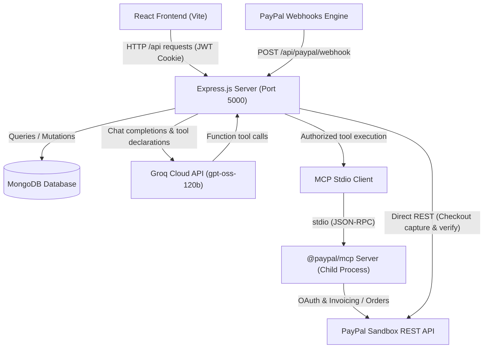

# RentMate 🏠📦

[](LICENSE)
[](https://nodejs.org/)
[](https://react.dev/)
[](https://github.com/paypal/agent-toolkit)
[](https://groq.com/)

> **Modern Rental Marketplace with Official PayPal Model Context Protocol (MCP) & Groq AI Agent Integration**

RentMate is a full-stack rental marketplace that makes high-quality furniture, home electronics, appliances, and work-from-home essentials accessible through flexible monthly leasing—eliminating large upfront purchasing expenses.

Equipped with an intelligent **AI Rental Assistant** powered by **Groq Cloud** and connected via the **official PayPal MCP Server (`@paypal/mcp`)**, RentMate allows tenants to search the live catalog, prepare instant lease proposals, manage PayPal Checkout orders, generate verified PayPal Invoices, and track payments through automated webhook reconciliation with strict user-level data isolation.

---

## 🌐 Live Demo & Repository

- **Live Application:** [https://rentmate-91e4.onrender.com](https://rentmate-91e4.onrender.com)
- **GitHub Repository:** [https://github.com/aryantiwari009/Rentmate](https://github.com/aryantiwari009/Rentmate)

---

## 📑 Table of Contents

- [RentMate 🏠📦](#rentmate-)
  - [🌐 Live Demo \& Repository](#-live-demo--repository)
  - [📑 Table of Contents](#-table-of-contents)
  - [✨ Features](#-features)
  - [🧠 AI Assistant Architecture \& PayPal MCP](#-ai-assistant-architecture--paypal-mcp)
    - [Key AI Capabilities](#key-ai-capabilities)
    - [Security \& Cross-User Isolation Layer](#security--cross-user-isolation-layer)
  - [💳 Payment System \& Webhook Reconciliation](#-payment-system--webhook-reconciliation)
    - [PayPal Checkout (Orders v2 API)](#paypal-checkout-orders-v2-api)
    - [PayPal Invoicing v2 \& Paid Receipt Auto-Conversion](#paypal-invoicing-v2--paid-receipt-auto-conversion)
    - [Verified Webhook Listener](#verified-webhook-listener)
    - [Currency Transparency \& Rounding](#currency-transparency--rounding)
  - [🛠 Technology Stack](#-technology-stack)
  - [🏛 Project Architecture](#-project-architecture)
    - [Directory Structure](#directory-structure)
    - [System Architecture Diagram](#system-architecture-diagram)
  - [🚀 Installation and Local Setup](#-installation-and-local-setup)
    - [Prerequisites](#prerequisites)
    - [1. Clone the Repository](#1-clone-the-repository)
    - [2. Install Dependencies](#2-install-dependencies)
    - [3. Configure Environment Variables](#3-configure-environment-variables)
    - [4. Seed Database](#4-seed-database)
    - [5. Run Locally](#5-run-locally)
  - [🔐 Environment Variables](#-environment-variables)
  - [📡 API Documentation](#-api-documentation)
  - [🛡 Security Architecture](#-security-architecture)
  - [🧪 Testing](#-testing)
    - [1. Cross-User Security \& Isolation Suite](#1-cross-user-security--isolation-suite)
    - [2. PayPal MCP Bridge Suite](#2-paypal-mcp-bridge-suite)
    - [3. Client Production Build](#3-client-production-build)
  - [☁ Deployment](#-deployment)
    - [Render Setup (Single Web Service)](#render-setup-single-web-service)
  - [🔮 Future Improvements](#-future-improvements)
  - [📄 License](#-license)

---

## ✨ Features

- **Product Discovery & Multi-Facet Filtering**: Filter items by category (Furniture, Electronics, Workstation, Appliances), monthly budget range, and availability with instant keyword search.
- **Curated Room & Lifestyle Bundles**: One-click multi-product leasing for pre-configured bundles (*Work From Home*, *Living Room Suite*, *Student Essentials*) matched dynamically against live catalog inventory.
- **JWT Authentication & Role Control**: Secure authentication using `httpOnly`, `SameSite` cookies, bcrypt-hashed credentials, and role-based permissions (`user` vs `admin`).
- **Flexible Booking Management**: Custom rental periods (1 to 24 months), dynamic security deposit calculations, booking cancellation, and rental history tracking.
- **Dual PayPal Checkout & Invoicing Integration**:
  - Instant online checkout via PayPal JavaScript SDK and Orders v2 API.
  - On-demand official PayPal Invoices sent via email with direct viewer links (`recipient_view_url`).
  - Automatic invoice payment reconciliation converting Checkout captures into paid invoice receipts.
- **Enterprise-Grade Webhook Synchronization**: Real-time handling of 9 PayPal invoicing events and 4 payment capture events with cryptographic signature verification, atomic deduplication, and out-of-order event protection.
- **Groq-Powered AI Rental Assistant**: Built on `openai/gpt-oss-120b` via Groq Cloud, offering conversational product search, interactive price proposals, and official PayPal MCP tool execution.
- **Responsive Theme System**: Native Light, Dark, and System theme switching with design tokens and zero-flash initialization.

---

## 🧠 AI Assistant Architecture & PayPal MCP

RentMate features a production-ready AI Assistant designed around the official **PayPal Model Context Protocol (MCP)** specification.

```
┌─────────────────┐      HTTP POST      ┌───────────────────────────────────┐
│  React Client   │ ──────────────────> │      RentMate Express Server      │
│ (Assistant.jsx) │ <────────────────── │  (server/src/services/assistant)  │
└─────────────────┘                     └───────────────────────────────────┘
                                                │                    │
                                     Function Calling        stdio Transport
                                                │                    │
                                                ▼                    ▼
                                       ┌────────────────┐   ┌─────────────────┐
                                       │   Groq Cloud   │   │  Official PayPal│
                                       │(gpt-oss-120b)  │   │   MCP Server    │
                                       └────────────────┘   │  (@paypal/mcp)  │
                                                            └─────────────────┘
                                                                     │
                                                             PayPal Sandbox API
                                                                     ▼
                                                            ┌─────────────────┐
                                                            │ PayPal Platform │
                                                            └─────────────────┘
```

### Key AI Capabilities
1. **LLM Provider**: **Groq Cloud** using the ultra-fast OpenAI-compatible API endpoint (`https://api.groq.com/openai/v1/chat/completions`).
2. **Model**: `openai/gpt-oss-120b` (configured via `AI_MODEL` in `.env`).
3. **Official PayPal MCP Server**: Connected to `@paypal/mcp` using `@modelcontextprotocol/sdk` over `stdio` child process transport.
4. **Dynamic Tool Discovery**: Automatically discovers available PayPal tools and maps them into OpenAI-standard function declarations:
   - `mcp_list_invoices`: Lists invoices with live status.
   - `mcp_get_invoice`: Retrieves real-time invoice details and payment records.
   - `mcp_create_invoice`: Creates payable PayPal invoices.
   - `mcp_send_invoice`: Sends an invoice to the tenant.
   - `mcp_cancel_sent_invoice`: Cancels an active invoice.
   - `mcp_create_order`: Initiates a PayPal payment order.
   - `mcp_get_order`: Checks order capture status.
   - `mcp_create_refund`: Initiates partial or full refunds.
   - `mcp_get_refund`: Inspects refund state.

### Security & Cross-User Isolation Layer
Because `@paypal/mcp` connects using merchant credentials, calling merchant-level tools directly could expose all tenant invoices. RentMate implements a server-side authorization gateway (`mcpAuthorizationService.js`):
- **Identity Binding**: The authenticated user ID is strictly extracted from `req.user._id`. LLM-supplied identities or arguments are ignored.
- **Isolated Invoice Listing**: The assistant queries RentMate's MongoDB for invoice IDs owned by the authenticated tenant, and queries PayPal MCP `get_invoice` only for authorized IDs. Regular users never see merchant-wide data.
- **Access Guard on Direct Retrieval**: Before executing `get_invoice`, the system verifies invoice and booking ownership in MongoDB. Unauthorized attempts are rejected with `Unauthorized` and logged as security alerts.
- **Sensitive Operations Protection**: Financial modifications (invoice cancellation, refunds) require ownership verification and explicit user confirmation (`confirmed: true`).
- **Administrative Tool Separation**: Store-wide tools (`list_transactions`, `list_disputes`, `accept_dispute_claim`) are strictly blocked for non-admin users.
- **PII Scrubbing**: Recipient emails and payer details returned to the AI are sanitized to match only the authenticated user.

---

## 💳 Payment System & Webhook Reconciliation

RentMate offers a cohesive payment flow combining instant Checkout with itemized PayPal Invoicing.

### PayPal Checkout (Orders v2 API)
- Tenants can click **Pay with PayPal** on any active rental.
- The backend creates an order using `/v2/checkout/orders` with breakdown calculations for monthly rent and refundable security deposit.
- When approved, `/v2/checkout/orders/{id}/capture` captures the payment, updates the booking payment status to `paid`, and locks the rental.

### PayPal Invoicing v2 & Paid Receipt Auto-Conversion
- Landlords or tenants can generate an invoice for any rental.
- For bookings already paid through PayPal Checkout, the system creates the invoice, sends it, and immediately records an external payment record (`POST /v2/invoicing/invoices/{id}/payments`) using the Checkout Capture ID.
- This transforms the invoice into a verified **PAID receipt**, preventing tenants from being billed twice for the same rental.
- Invoice view URLs resolve to PayPal's official canonical `recipient_view_url` (`https://www.sandbox.paypal.com/invoice/p/#<token>`).

### Verified Webhook Listener
RentMate listens for PayPal webhook notifications at `POST /api/paypal/webhook` and `POST /api/payments/webhook`:
- **Cryptographic Signature Verification**: Validates all incoming headers (`paypal-auth-algo`, `paypal-cert-url`, `paypal-transmission-id`, `paypal-transmission-sig`, `paypal-transmission-time`) against PayPal's verification endpoint (`/v1/notifications/verify-webhook-signature`) using `PAYPAL_WEBHOOK_ID`.
- **Supported Invoice Events**:
  - `INVOICING.INVOICE.CREATED`
  - `INVOICING.INVOICE.SENT`
  - `INVOICING.INVOICE.PAID`
  - `INVOICING.INVOICE.CANCELLED`
  - `INVOICING.INVOICE.UPDATED`
  - `INVOICING.INVOICE.REFUNDED`
  - `INVOICING.INVOICE.PARTIALLY_REFUNDED`
  - `INVOICING.INVOICE.PAYMENT_FAILED`
  - `INVOICING.INVOICE.SCHEDULED`
  - `INVOICING.INVOICE.REMINDER_SENT`
- **Supported Payment Events**:
  - `PAYMENT.CAPTURE.COMPLETED`
  - `PAYMENT.CAPTURE.PENDING`
  - `PAYMENT.CAPTURE.DENIED`
  - `PAYMENT.CAPTURE.REFUNDED`
- **Race-Safe Idempotency**: Atomic upsert in `WebhookEvent` model ensures each webhook event is processed exactly once.
- **Out-of-Order Protection**: State ranking prevents outdated webhook events from overwriting terminal states like `PAID` or `CANCELLED`.

### Currency Transparency & Rounding
- **Primary Display Currency**: RentMate displays all rental fees, monthly costs, and security deposits in **Indian Rupees (INR, ₹)**.
- **Sandbox Transaction Currency**: PayPal sandbox transactions run in **USD ($)**.
- **Conversion Math**: `server/src/utils/currency.js` converts INR to USD using `INR_PER_USD` (default: 85).
- **Zero Penny Discrepancy**: Rental and deposit amounts in USD are mathematically balanced so that `rentTarget + depositTarget === totalTarget` down to the exact cent, eliminating PayPal validation errors.

---

## 🛠 Technology Stack

| Layer | Technologies |
|---|---|
| **Frontend** | React 18, Vite 6, React Router 7, Lucide Icons, Custom Design Token CSS |
| **Backend** | Node.js (>= 20.0.0), Express 5, Mongoose 9, MongoDB |
| **AI / Agent** | Groq Cloud (`openai/gpt-oss-120b`), `@modelcontextprotocol/sdk`, `@paypal/mcp` |
| **Payments** | PayPal JavaScript SDK, PayPal Orders v2, Payments v2, Invoicing v2, Webhooks v1 |
| **Security** | JWT (`httpOnly` cookies), `bcryptjs`, `express-rate-limit`, Webhook HMAC Verification |
| **Hosting** | Render Web Service (Single Unified Service) |

---

## 🏛 Project Architecture

### Directory Structure

```
RentMate/
├── client/                     # Frontend Application (React + Vite)
│   ├── src/
│   │   ├── components/         # UI Components (Nav, Footer, PayButton, ThemeToggle, ProductGrid)
│   │   ├── context/            # Global React Contexts (AuthContext)
│   │   ├── data/               # Curated bundle definitions & fallback catalog
│   │   ├── pages/              # Views (Home, Explore, Product, Rentals, Checkout, Assistant, Saved)
│   │   ├── utils/              # Utilities (api client, auth helpers, theme engine)
│   │   ├── App.jsx             # Route definitions & layout wrappers
│   │   ├── main.jsx            # React root entry point
│   │   └── styles.css          # Design-token-based responsive stylesheet
│   ├── index.html              # HTML shell with theme initialization script
│   ├── package.json            # Client dependencies & scripts
│   └── vite.config.js          # Vite configuration with /api development proxy
│
├── server/                     # Backend API & MCP Server Host (Express)
│   ├── src/
│   │   ├── config/             # Database connection (Mongoose/MongoDB)
│   │   ├── controllers/        # Route controllers (auth, booking, payment, webhook, assistant)
│   │   ├── middleware/         # Security middlewares (requireAuth)
│   │   ├── models/             # Mongoose schemas (User, Product, Booking, Invoice, WebhookEvent)
│   │   ├── routes/             # Express API routes (/auth, /products, /bookings, /payments, /assistant)
│   │   ├── seed/               # Initial catalog seeding scripts
│   │   ├── services/           # Core domain logic:
│   │   │   ├── assistantService.js         # Groq LLM tool calling loop
│   │   │   ├── bookingService.js           # Booking price preparation
│   │   │   ├── mcpAuthorizationService.js  # Cross-user authorization & MCP security guard
│   │   │   ├── paypal.js                   # PayPal REST API client & webhook signature verification
│   │   │   ├── paypalMcpService.js         # Official @paypal/mcp stdio client lifecycle
│   │   │   └── productSearch.js            # MongoDB filter & search builder
│   │   ├── utils/              # Currency conversion and monetary math
│   │   └── server.js           # Express app bootstrap, static client serving, and middleware
│   ├── package.json            # Server dependencies, engines, and test scripts
│   ├── test_mcp.js             # PayPal MCP tool discovery and Groq assistant bridge test
│   └── test_security_isolation.js # 15-point cross-user data isolation regression test
│
├── LICENSE                     # MIT License
└── README.md                   # Project documentation
```

### System Architecture Diagram



---

## 🚀 Installation and Local Setup

### Prerequisites
- **Node.js**: `v20.0.0` or higher
- **MongoDB**: Local MongoDB instance or MongoDB Atlas URI
- **PayPal Developer Account**: Sandbox Client ID, Secret, and Webhook ID from [developer.paypal.com](https://developer.paypal.com)
- **Groq Cloud Account**: API Key from [console.groq.com](https://console.groq.com)

### 1. Clone the Repository
```bash
git clone https://github.com/aryantiwari009/Rentmate.git
cd Rentmate
```

### 2. Install Dependencies
```bash
# Install server dependencies
cd server
npm install

# Install client dependencies
cd ../client
npm install
cd ..
```

### 3. Configure Environment Variables
Create a `.env` file inside the `server/` directory:

```bash
cp server/.env.example server/.env   # or create manually
```

Populate `server/.env` with your credentials:
```env
PORT=5000
NODE_ENV=development
MONGO_URI=mongodb://127.0.0.1:27017/rentmate
JWT_SECRET=your_jwt_secret_key_minimum_32_characters

# Groq Cloud LLM Configuration
AI_API_KEY=gsk_your_groq_api_key_here
AI_BASE_URL=https://api.groq.com/openai/v1/
AI_MODEL=openai/gpt-oss-120b

# PayPal Sandbox Configuration
PAYPAL_CLIENT_ID=your_paypal_sandbox_client_id
PAYPAL_CLIENT_SECRET=your_paypal_sandbox_client_secret
PAYPAL_WEBHOOK_ID=your_paypal_sandbox_webhook_id
PAYPAL_API=https://api-m.sandbox.paypal.com
PAYPAL_CURRENCY=USD
INR_PER_USD=85
```

### 4. Seed Database
Populate your MongoDB database with sample furniture, electronics, and appliances:
```bash
npm run seed --prefix server
```

### 5. Run Locally

Open two terminal tabs:

**Terminal 1 (Backend Server):**
```bash
npm run dev --prefix server
# Server listening on http://localhost:5000
```

**Terminal 2 (Frontend Client):**
```bash
npm run dev --prefix client
# Vite running on http://localhost:5173
```

Visit `http://localhost:5173` in your browser. All API calls to `/api` will be proxied automatically to `http://localhost:5000`.

---

## 🔐 Environment Variables

| Variable | Scope | Required | Description | Example |
|---|---|---|---|---|
| `PORT` | Backend | Optional | Port for the Express server | `5000` |
| `NODE_ENV` | Backend | Required | Execution environment | `development` / `production` |
| `MONGO_URI` | Backend | Required | MongoDB connection string | `mongodb://127.0.0.1:27017/rentmate` |
| `JWT_SECRET` | Backend | Required | Secret for signing auth tokens | `secure_random_key_string` |
| `AI_API_KEY` | Backend | Required | Groq Cloud API authentication key | `gsk_...` |
| `AI_BASE_URL` | Backend | Required | OpenAI-compatible endpoint | `https://api.groq.com/openai/v1/` |
| `AI_MODEL` | Backend | Required | Model identifier on Groq | `openai/gpt-oss-120b` |
| `PAYPAL_CLIENT_ID` | Backend | Required | PayPal developer sandbox app client ID | `AXXX...` |
| `PAYPAL_CLIENT_SECRET` | Backend | Required | PayPal developer sandbox app secret | `EXXX...` |
| `PAYPAL_WEBHOOK_ID` | Backend | Required | Webhook ID for signature verification | `8XX...` |
| `PAYPAL_API` | Backend | Required | PayPal base API endpoint | `https://api-m.sandbox.paypal.com` |
| `PAYPAL_CURRENCY` | Backend | Required | Target transaction currency | `USD` |
| `INR_PER_USD` | Backend | Required | Conversion rate from INR to USD | `85` |

> **Note on Frontend:** The React client does not require external environment variables. In local development, Vite proxies `/api` to localhost:5000; in production, Express serves the built client assets directly from `client/dist`.

---

## 📡 API Documentation

### Authentication (`/api/auth`)
- `POST /api/auth/register` – Register a new tenant account.
- `POST /api/auth/login` – Authenticate with email/password; receives `httpOnly` JWT cookie.
- `POST /api/auth/logout` – Clear authentication cookie.
- `GET /api/auth/me` – Retrieve current authenticated user profile (`requireAuth`).

### Product Catalog (`/api/products`)
- `GET /api/products` – Query catalog with filters (`category`, `maxPrice`, `search`, `available`).
- `GET /api/products/:id` – Retrieve detailed product information.

### Bookings (`/api/bookings`)
- `POST /api/bookings` – Create a rental booking (`requireAuth`).
- `GET /api/bookings` – Retrieve authenticated user's active and past bookings (`requireAuth`).
- `PATCH /api/bookings/:id/cancel` – Cancel an active booking (`requireAuth`).

### Payments & Invoicing (`/api/payments`)
- `GET /api/payments/config` – Retrieve PayPal client ID and currency settings (`requireAuth`).
- `POST /api/payments/create-order` – Create PayPal checkout order for a booking (`requireAuth`).
- `POST /api/payments/capture` – Capture PayPal payment and mark booking as paid (`requireAuth`).
- `POST /api/payments/create-invoice` – Generate/reconcile PayPal invoice or receipt (`requireAuth`).
- `GET /api/payments/invoice/:bookingId` – Get live invoice status and payer link (`requireAuth`).
- `GET /api/payments/history/:bookingId` – Get full invoice lifecycle and audit history (`requireAuth`).
- `POST /api/payments/webhook` – PayPal Webhook receiver (alias for `/api/paypal/webhook`).

### PayPal Webhooks (`/api/paypal`)
- `POST /api/paypal/webhook` – Official webhook endpoint; verifies signature with PayPal API and reconciles bookings and invoices.

### AI Assistant (`/api/assistant`)
- `POST /api/assistant/chat` – Conversational AI assistant endpoint (`requireAuth`, rate-limited to 10 req/min).

### Health Check
- `GET /api/health` – Returns `{ ok: true, message: "RentMate is up and running" }`.

---

## 🛡 Security Architecture

1. **Strict User Ownership Authorization**:
   - Every invoice, order, and booking operation checks user ownership against `req.user._id`.
   - Tenants can never inspect, modify, or cancel invoices belonging to another user.
2. **AI Tool Isolation Guard**:
   - The AI Assistant routes all MCP tool executions through `mcpAuthorizationService.js`.
   - Raw merchant-wide invoice data is blocked; only invoices registered to the user's MongoDB record can be retrieved.
3. **Cryptographic Webhook Verification**:
   - Webhook events are verified against PayPal's public keys using `/v1/notifications/verify-webhook-signature`. Unverified events are rejected.
4. **Idempotency & Out-of-Order Safety**:
   - `WebhookEvent` model utilizes atomic upsert on `eventId` to prevent duplicate processing.
   - Status rank logic ensures delayed events cannot roll back an invoice or booking that has already completed payment.
5. **Cookie Security**:
   - Session JWTs are stored in `httpOnly`, `SameSite=Lax` cookies, eliminating exposure to XSS token theft.
6. **Rate Limiting**:
   - Protected with `express-rate-limit` on authentication, checkout, and AI assistant endpoints.

---

## 🧪 Testing

RentMate includes verified automated test suites to ensure security, MCP tool discovery, and build integrity:

### 1. Cross-User Security & Isolation Suite
Tests data isolation between multiple tenants (User A, User B, User C), confirming that no tenant can view or cancel another tenant's invoices through the AI assistant or MCP tools:
```bash
npm run test:security --prefix server
# or: npm test --prefix server
```
*Result: 15/15 passing tests verifying strict ownership, 403 blocks, confirmation requirements, and PII sanitization.*

### 2. PayPal MCP Bridge Suite
Verifies connection to the official PayPal MCP Server via stdio, tools discovery, direct tool execution, and the Groq AI bridge:
```bash
npm run test:mcp --prefix server
```
*Result: Verifies discovery of 28 official PayPal tools and end-to-end model tool calling.*

### 3. Client Production Build
Ensures React frontend compiles with zero syntax errors or missing dependencies:
```bash
npm run build --prefix client
```

---

## ☁ Deployment

### Render Setup (Single Web Service)

RentMate is configured for deployment as a unified Web Service on [Render](https://render.com), serving both the Express backend API and the Vite-built frontend.

- **Root Directory:** Repository root (`.`)
- **Environment:** `Node` (Node.js >= 20.0.0)
- **Build Command:**
  ```bash
  npm install --include=dev --prefix client && npm run build --prefix client && npm install --prefix server
  ```
- **Start Command:**
  ```bash
  npm start --prefix server
  ```

In production, `server.js` automatically serves the static production build from `client/dist` for all non-API GET routes.

---

## 🔮 Future Improvements

- **Recurring Subscriptions via PayPal**: Integrate PayPal Subscriptions API (`create_subscription` MCP tool) for automatic monthly credit card deduction.
- **Landlord Item Upload Portal**: Cloudinary-backed direct image upload interface for landlords listing new rental assets.
- **Dynamic Forex Exchange Rates**: Integration with live exchange rate APIs to continuously update the `INR_PER_USD` rate.
- **Automated Lease Renewal Reminders**: Automated email and in-app notifications 7 days prior to rental expiration.

---

## 📄 License

This project is licensed under the **MIT License** - see the [LICENSE](LICENSE) file for details.

Copyright (c) 2026 Aryan Tiwari
